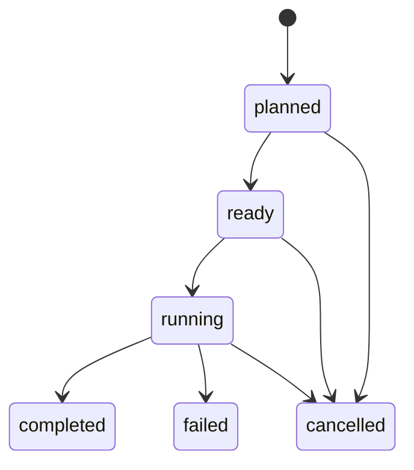

# Activity Lifecycle — v0.2 Proposal

**Status:** Proposed; requires the [Issue #3 quality gate](https://github.com/chadtalty/cge/issues/3).  
**Scope:** Execution-independent conceptual contract. No runtime, storage implementation, or executable schema is supplied.  
**Builds on:** [Conceptual model](conceptual-model.md) and [decomposition workflow](../workflows/decomposition.md).

## Intent

Distinguish what work is defined, which bounded work item is being performed, and each attempt to perform it. Keep failed attempts and rejected outputs attributable to their original context. Completing an execution does not approve its outputs or advance the workflow automatically.

The terms **must** and **may** below express requirements and options within this proposal; they do not claim existing enforcement.

## Identity and version boundaries

These are supporting identities within the existing Activity abstraction, not additional core abstractions.

| Identity | Meaning | Version behavior |
| --- | --- | --- |
| `activity_definition_ref` | Reusable contract: objective, input/output requirements, scope, phase, executor role, completion checks, stopping conditions, and gate requirements | Exact definition version; editing the contract creates a new version |
| `activity_id` | A bounded work item instantiated for a request within a workflow instance | Stable through its attempt history; materially different objectives create a new activity |
| `attempt_id` | One execution attempt for that work item | Unique; terminal attempts are never reopened |
| `workflow_instance_id` | The particular request's passage through a workflow | Stable; governing workflow definition versions remain pinned |
| `execution_manifest_ref` | Versioned binding of this attempt to its definition, context, inputs, workflow, executor role, and authority | Sealed at readiness; earlier draft revisions remain identifiable |

A retry uses a new `attempt_id`, even when the definition and inputs are identical. A rework attempt also uses a new `attempt_id` and identifies the findings or changed inputs it addresses. The work item's current-attempt pointer is a projection; it must not erase prior attempts.

## Execution manifest

Before becoming `ready`, an attempt must bind:

- The activity definition version and workflow definition version, including its SDLC phase and scope boundaries.
- A context version and immutable references for every required input. Capture mutable issue bodies as versioned snapshots.
- Expected output types, completion checks, stopping conditions, and the relevant gate definition version.
- Executor identity or accountable team and the executor role required to claim execution.
- An authorization-policy version and the evidence required to authorize starting work.
- A predecessor attempt and relationship (`retry` or `rework`) when applicable, with rationale and findings references.

While `planned`, missing inputs are explicitly recorded and manifest drafts may be revised. The readiness transition pins the sealed manifest version. After readiness, changing any binding requires cancellation of a nonterminal attempt and a new successor; terminal attempts retain their original bindings.

At a GitHub boundary, an artifact reference includes repository identity, path, and full commit SHA. A context manifest pins its dependencies the same way, including across repositories. A branch, issue URL, tag that can move, or the word `latest` is insufficient as the sole version identifier.

## Attempt states

| State | Meaning |
| --- | --- |
| `planned` | Attempt exists; input readiness and execution authorization have not both been established |
| `ready` | Manifest is sealed, required inputs are available, and readiness prerequisites are satisfied |
| `running` | An authorized executor has claimed this attempt and may act within its scope |
| `completed` | Execution completion checks passed and exact output/evidence versions are recorded; gate approval remains separate |
| `failed` | Execution stopped without satisfying the completion contract; failure and partial-output disposition are recorded |
| `cancelled` | Execution was explicitly stopped or withdrawn; effects and outstanding work were reconciled |

`completed`, `failed`, and `cancelled` are terminal. Waiting for clarification or a dependency is an annotated condition on `planned` or `running`, not an implicit transition. A running attempt must obey its stopping conditions while waiting.

## Allowed transitions

Creation records `attempt.created` with initial state `planned`. Every subsequent transition must record the previous and new state, manifest version, responsible actor, authorization evidence, rationale, and triggering evidence. Event envelopes are defined in the [audit model](audit-model.md).

| From | To | Required conditions and evidence | Event |
| --- | --- | --- | --- |
| `planned` | `ready` | Required inputs pinned and available; scope, executor role, gate, and authority policy identified; manifest sealed | `attempt.readied` |
| `ready` | `running` | Authorized executor claims the attempt; scope and prerequisite checks still hold; conflicting claims excluded | `activity.started` |
| `running` | `completed` | Output versions and completion-check results recorded; scope respected; outstanding effects reconciled | `activity.completed` |
| `running` | `failed` | Stopping condition, error, or deadline prevents completion; failure evidence and known/unknown effects recorded; further execution fenced or stopped | `activity.failed` |
| `planned`, `ready`, or `running` | `cancelled` | Authorized cancellation is effective; execution is stopped or fenced; partial outputs and effects have an explicit disposition | `activity.cancelled` |

All other transitions are disallowed. An invalid or unauthorized request leaves state unchanged and produces a `transition.denied` record with the reason. A failed readiness check leaves the attempt `planned`; a failed completion check leaves it `running` for bounded correction or causes `failed` when a stopping condition applies. It never creates a successful completion event.

## Retry, rework, and cancellation

| Situation | Required handling |
| --- | --- |
| Transient execution failure, same governing bindings | An authorized actor creates a new planned attempt with `retry_of`; verify retry eligibility and reconcile prior effects before starting |
| Changed context, input, contract, or scope within the same objective | Create a new planned attempt with `rework_of` and new pinned bindings; record the change rationale |
| Gate requests changes after execution completed | Keep the completed attempt intact; route the workflow to rework and create a successor linked to the gate findings |
| Objective or phase boundary materially changes | Create a new activity/workflow handoff and trace it to the previous work; do not stretch the old activity's scope |
| Duplicate command delivery | Recognize the same command identifier and return the recorded result; do not create another execution attempt |
| Cancellation requested during execution | Record `cancellation.requested`; treat the attempt as running until effects are reconciled and cancellation becomes effective |

A retry is not permission to repeat irreversible effects. Record completed external actions, use idempotency where available, and require reconciliation or explicit compensating work when the outcome is unknown. Cancellation never implies rollback. Failed or cancelled attempts retain partial artifacts, marked as unaccepted outputs; reuse requires explicit validation and a pinned input reference in the successor.

A deadline may cause `failed` only when continued execution has been stopped or fenced. Late artifacts or events do not revive a terminal attempt; retain and flag them for reconciliation, and require an authorized decision before treating them as inputs to subsequent work.

## Gates and workflow progression

A gate evaluation has its own identity and pins the context, evidence bundle, activity attempt, gate-definition version, and authority policy evaluated. Its result (`approved`, `changes_requested`, or `rejected`) is separate from attempt state. A completed attempt can therefore have rejected outputs.

In the reference architecture workflow:

1. Completion of a decomposition attempt permits requesting architecture review when the workflow prerequisites also hold.
2. An authorized architecture reviewer evaluates a sealed evidence bundle and records a gate decision.
3. Approval permits a separate authorized transition to `Ready for implementation`; a failed prerequisite leaves the workflow unchanged.
4. Changes requested or rejection route to `Architecture rework`. A successor attempt addresses the findings and supplies a new bundle for a new evaluation.

Approval applies only to its evaluated versions and declared scope. Subsequent edits do not inherit it. A material issue change requires refreshed snapshots, a successor attempt where relevant, and reevaluation. Record the change's effect on existing approvals and downstream work; the workflow owner must pause affected progression and decide what requires rework. Earlier approval evidence remains historical evidence, not authorization for the changed scope.

## Authority and concurrency

Human, agent, script, and hybrid execution must provide attributable identities and satisfy the same transition preconditions. An agent's role claim or a passing check is not authorization. Record the actual executor and accountable principal, delegation limits, policy version, and the decision allowing the action. Recheck applicable grants at action time; a pinned policy does not keep a revoked grant alive.

The workflow declares whether self-approval is permitted. The manual architecture reference uses a designated reviewer distinct from the executor. Automated gate approval requires an explicit policy assigning that authority and its limits.

An activity instance has at most one nonterminal attempt in this reference profile. Parallel work is decomposed into separate activity instances. State changes require the expected current state and per-attempt sequence, plus an exclusive claim while running. A concurrent or stale command must fail without silently overwriting state.

Manual execution can use a designated coordinator, an explicit execution claim, and sequential ledger entries. Automation may use conditional writes or equivalent controls. In either case, a transition and its audit evidence must be durably reconcilable before dependent progression. If either state or event persistence is uncertain, record/reconcile the uncertainty and stop dependent advancement.

## Review decisions still required

- Confirm the six-state minimum and the one-nonterminal-attempt reference profile.
- Choose policy conventions for delegation expiry, separation of duties, and approval invalidation across downstream activities.
- Select storage, locking, recovery, and integrity mechanisms for a later implementation. Manual coordination is a reference procedure, not an atomic database guarantee.
- Decide whether a later executable schema needs more detailed waiting/timeout states. This proposal intentionally models them through conditions and stopping rules.

See the [worked decomposition example](../../examples/decomposition-request/README.md) for execution failure, retry, gate rework, and manual authorization.
