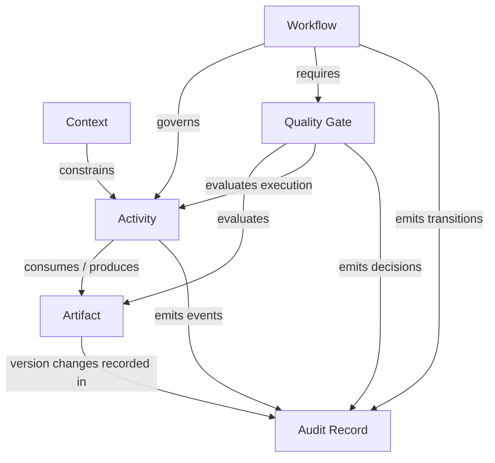

# CGE Conceptual Architecture v0.1

**Status:** Proposed  
**Scope:** Technology-independent conceptual model  
**Source:** [Architecture request #1](https://github.com/chadtalty/cge/issues/1)

## Definition

Context Governed Engineering (CGE) is an execution-independent, specification-driven engineering framework that governs work across the SDLC through explicit context, bounded activities, deterministic workflow controls, versioned artifacts, quality gates, and auditable records.

CGE extends SDD rather than replacing it. Specifications remain authoritative inputs to engineering activities; CGE adds a consistent execution and governance model around them. This does not imply that existing SDD approaches lack workflow or governance capabilities.

## Six core abstractions

### 1. Context

A **Context** is a versioned, explicitly scoped collection of information necessary to perform or evaluate work: objectives, specifications, constraints, assumptions, dependencies, relevant decisions, permissions, and artifact references.

**Invariant:** An activity execution must reference an identifiable context version. Context may evolve, but historical executions retain their original context reference.

### 2. Activity

An **Activity** is a bounded unit of engineering work with an objective, input contract, permitted scope, executor role, expected outputs, acceptance criteria, and stopping conditions.

An activity *definition* describes the work; an *execution* is one attempt by a human, agent, script, or hybrid team. Attempts must be distinguishable for audit purposes.

**Invariant:** Every activity execution identifies its governing context, scope, and completion or failure outcome.

### 3. Artifact

An **Artifact** is a persistent, identifiable, versioned engineering output or evidence item, such as a specification, analysis, design, ADR, test result, or deployment manifest.

**Invariant:** A quality gate evaluates specific artifact versions, not an ambiguous mutable latest state.

### 4. Workflow

A **Workflow** defines activities, lifecycle phase boundaries, dependencies, permitted states and transitions, exception paths, and required approvals.

**Invariant:** Workflow transitions require their declared preconditions and must produce auditable transition evidence. Determinism applies to the workflow contract and permitted transitions—not to identical human or AI reasoning outputs.

### 5. Quality Gate

A **Quality Gate** is an explicit evaluation boundary with criteria, required evidence, responsible authority, and a result such as approved, rejected, or changes requested.

**Invariant:** Gate decisions reference the exact evaluated context and artifact versions. Approval is not inferred from a successful file write or passing automated check unless the workflow explicitly authorizes that decision.

### 6. Audit Record

An **Audit Record** is an append-only, structured account of a meaningful engineering event: activity execution, artifact change, decision, gate evaluation, or workflow transition.

Minimum conceptual fields: record ID, event type, timestamp, actor identity and type, subject identifiers, context version, relevant artifact versions, outcome, rationale or evidence references, and correlation/causation references where applicable.

**Invariant:** Corrections are new records referencing the corrected record; existing history is not silently overwritten. Storage integrity and retention remain implementation responsibilities.

## Relationships



Traceability is a **cross-cutting relationship capability**, not a synonym for the audit log. Stable identifiers link requests, activities, contexts, artifact versions, gate evaluations, decisions, and releases. Audit records preserve *what happened*; trace links describe *what relates to what*.

## Conceptual activity contract

```yaml
activity:
  id: ACT-ARCH-DECOMPOSE
  workflow_phase: architecture
  objective: Decompose an intake request into independently testable, deployable features
  context_ref: CTX-EXAMPLE@v1
  inputs:
    - request_ref: ISSUE-1
  scope:
    permitted: [analyze, propose_features, produce_design_artifacts]
    excluded: [merge_implementation, deploy]
  executor_role: architect
  outputs:
    - feature_definitions
    - analysis
    - design
    - planning
  completion:
    - features_have_clear_boundaries
    - artifacts_are_versioned_and_linked
  gate_ref: GATE-ARCH-REVIEW
  audit:
    required_events: [activity.started, artifact.produced, activity.completed, gate.evaluated]
```

The contract is illustrative, not a finalized machine-readable schema.

## Execution independence

A human architect may read an issue, author Markdown artifacts, and submit a pull request. An AI agent may perform the same activity within the same permissions and contract. Governance requirements remain constant; executor-specific procedures and permissions may differ.

## SDLC boundaries

Phases are configurable. The reference flow begins with **intake → architecture/decomposition → implementation → verification → delivery**, with explicit gates at defined handoffs. A phase boundary is a governance condition, not necessarily a separate team or repository.

## Open design questions

1. Should Context be represented as an immutable snapshot, a versioned manifest of references, or both?
2. What is the minimal common activity state machine, including retries and cancellation?
3. Which audit events must be first-class versus derived from tool-native history?
4. How are human approvals, delegated authority, and automated gate decisions represented?
5. How do cross-repository artifacts and multi-feature decompositions retain stable identities?

These questions are intentionally unresolved in v0.1.
