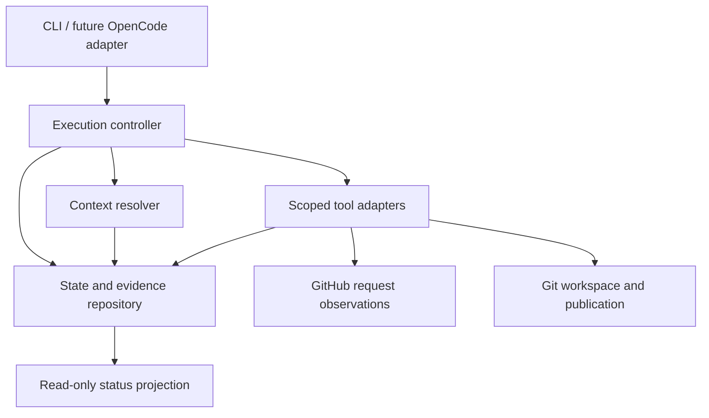

# Runner MVP Architecture

**Status:** Proposed; no runner is implemented.  
**Request:** [Issue #5](https://github.com/chadtalty/cge/issues/5).  
**Contract:** [Runner MVP specification](../specification/runner-mvp.md).

## Component responsibilities

| Component | Responsibility | Boundary |
| --- | --- | --- |
| CLI adapter | Parse explicit commands/config, obtain actor identity and request an operation | No hidden agent prompts or automatic policy relaxation |
| Execution controller | Evaluate contracts, prerequisites, expected state/sequence, authority, scope and completion | Core does not depend on GitHub or an AI executor |
| Context resolver | Retain source observations, resolve exact revisions, select minimum sufficient context | Does not treat request text as executable instructions or authority |
| State/evidence repository | Store events, command identities, claims, projections, evidence hashes and operation intents | Durable transitions precede dependent effects/progression |
| GitHub request adapter | Read issue body/metadata; return observation and provenance | No implicit issue edits, feature creation, or approvals |
| Git workspace adapter | Inspect/create controlled checkouts and recorded branch; report exact effects | No destructive cleanup or force push |
| Publication adapter | Export allowlisted evidence and reconcile/push one identified export when explicitly requested | Separate authorization/outcome; no PR merge or gate decision |
| Diagnostic projector | Produce scope-labelled status and stdout receipt from retained facts | Read-only and local; no recovery or network refresh |

Potential engineering specialists and an OpenCode orchestrator sit outside this first slice. Later adapters call these same controller contracts instead of reimplementing state rules.

## Proposed storage and workspace layout

| Location relative to the configured workspace root | Purpose |
| --- | --- |
| `state.sqlite` | Authoritative command intents, canonical request mapping, accepted event/state transactions, claims and publication records for all requests under this root |
| `requests/<scope-key>/evidence/sha256/<digest>` | Retained immutable input/output bytes; validate names against actual hashes and disallow symlink escapes |
| `requests/<scope-key>/framework/` | Separate framework checkout at the pinned full commit; treated as read-only |
| `requests/<scope-key>/work/` | Controlled work repository checkout on its recorded request branch |
| `requests/<scope-key>/exports/<export-id>/` | Rebuildable, allowlisted governance bundle with a fixed manifest/cutoff |

A request workspace is the fixed `requests/<scope-key>` directory. Its metadata contains its scope key, not an arbitrary database path; `status` resolves the configured root using this fixed layout and validates the root/database identity. The root database maps canonical request keys to workspaces and holds preflight command intents before provider identity is known. Initial implementation targets local filesystems on one machine; shared/network filesystems and distributed concurrent executors are unsupported until separately designed. The SQLite file itself is not the immutable artifact namespace or a public artifact. See [ADR-0003](../decisions/0003-local-state-and-evidence.md).

A future runner repository layout may separate `cli`, `controller`, `contracts`, `context`, `storage`, `adapters`, and `tests`. This proposal does not create empty code directories or imply an implementation language was accepted.

## Evidence persistence protocol

1. Retain a command intent before provider discovery, then resolve canonical identity and retain metadata observations. Atomically bind the request scope and record the initial attempt before request-content retrieval or substantive repository effects.
2. For each retained observation or output, write bytes to a same-filesystem temporary file, flush, hash and atomically install under its digest; synchronize durability as supported by the accepted platform policy.
3. In a transaction, reference only installed/verified evidence, append accepted events, and update the state projection using the expected state/sequence.
4. If the evidence write succeeds but the transaction fails, the unreferenced blob is not an accepted result. Preserve it for reconciliation; no automatic deletion is necessary in the MVP.
5. If evidence is missing or corrupt at read/recovery time, report integrity/recovery failure and block dependent advancement. Backups and export do not authorize silent reconstruction of missing facts.

Filesystem and database operations are not one atomic transaction. The protocol deliberately prefers harmless unreferenced blobs over database references to unretained bytes. Completion is not reported until required completion evidence and its accepted event/projection transaction are durable. Platform-specific crash/power-loss guarantees must be verified in the implementation work package; they are not established by this design.

## Tool contracts and external effects

Every adapter operation returns structured `operation_id`, inputs/digests, permitted effect, observation time, tool/environment identity, outcome, actual effect references, evidence references, error classification, and retry safety. The controller assigns a stable operation identity and records an intent before branch/commit/push effects.

On success, retain observed results before accepting the next dependent transition. On interruption, observe the external system to reconcile the intended operation; do not infer success from a missing local receipt or a timeout. Reuse an observed branch/commit only when its identity, recorded ownership marker and expected base/bundle match. Refuse unrelated matching names. Remote observations and flaky checks are evidence, not deterministic conclusions.

Publication is a separate bounded activity with its own sealed manifest and attempt lifecycle, consuming a completed initialization and its exact export. It never appends new workspace effects to a terminal initialization attempt. Publication serializes the evidence manifest at an explicit cutoff, creates a local export commit once, and records that commit before push. Reconciliation compares the remote branch/commit with the recorded export. A failed/unknown push cannot cause regeneration of a different commit and blind repetition. The receipt is a later record outside its described export, avoiding self-referential evidence.

## Identity, claims, and recovery

Use canonical provider IDs and retained request metadata to distinguish stable identity from display names. Record the activity instance and attempt separately; one active attempt per instance is the initial profile rule. New command IDs do not automatically mean new attempts.

Transactions serialize expected state/sequence and command identity. An exclusive local execution claim prevents competing executors. A claim is not released by time alone while the old process might still execute. The implementation must establish a single-host process/lock ownership protocol; if death/fencing cannot be established, report recovery-required and stop. Authority is revalidated on resume and before controlled effects.

Terminal failed attempts require explicit retry with unchanged eligible bindings and reconciled effects. Changed sealed context requires impact assessment and a governed successor; general rework/cancellation command support is deliberately deferred. The controller must report that limitation rather than reopen an attempt or hide a changed input.

## Status and governance dimensions

`status` reads a consistent local snapshot without creating files, changing SQLite journal settings, recovering the ledger, or contacting GitHub. It reports the snapshot/sequence observed and last provider observation time. A standalone stdout receipt may be captured by an audited caller; the diagnostic itself is not represented as a completed engineering activity. Acceptance of this classification is required in [ADR-0004](../decisions/0004-runner-identity-and-resume.md).

Project work, attempt lifecycle, ADR status, verification scope/coverage, gate readiness, confidence and publication are separate projections. For example, local initialization can be completed while downstream design approval is blocked and evidence publication is failed. No overall green badge may collapse those facts into feature readiness.

## Permissions and credential boundary

The operator supplies trusted profile configuration and credential access through environment/credential facilities, never issue-provided commands. Logs and manifests retain identity and permission scope, not token values. Configuration pins policy bytes and accepted decisions while checking current authority; changed policies require a new governed binding, and revoked grants deny action.

The default adapter can read requests and prepare local work. Remote export requires a separately authorized publication flag/operation and content/audience allowlist. The MVP rejects policies requiring remote evidence retention before completion and profiles requiring adapters/audit wrappers it does not implement.

## Deferred capabilities

General activity scheduling and execution waves; engineering-agent execution; Jira/GitLab adapters; OpenCode extension; full artifact catalog; executable contract schemas; automated gate approval; cross-machine claims; release/deployment; and enterprise retention/integrity controls are outside this slice. The [verification plan](../verification/runner-mvp-plan.md) defines how to test the chosen subset and its refusals before operational use.
